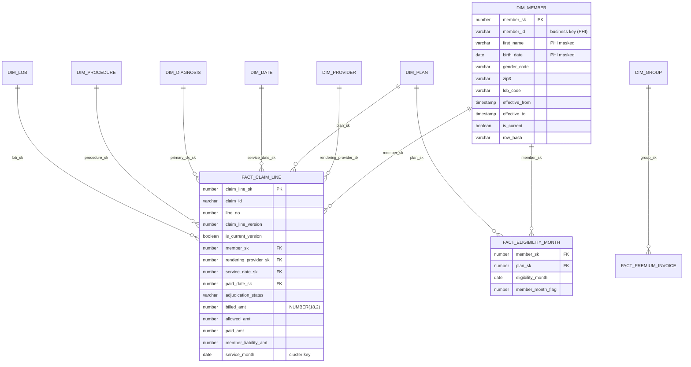

# Data Model — "Only fact/dim, or marts too?"

**Short answer:** both, in layers. We did **not** stop at a fact/dim star, and we
did **not** build marts straight off staging. The model is:

```
RAW (source-shaped)  →  STAGE (cleansed, source-shaped)  →  CORE (Kimball conformed star)
                                                           →  MART (subject-area aggregates, Dynamic Tables)
                                                           →  LEGACY_COMPAT (old EDW table shapes, views)
```

| Layer | Modelling style | Who queries it |
|---|---|---|
| RAW / STAGE | Source-system shaped (3NF as in the OLTP) | Engineers only |
| **CORE** | **Kimball dimensional**: conformed dimensions + atomic-grain facts, surrogate keys, SCD2 | Actuaries, data scientists, power users, marts |
| **MART** | Aggregated subject areas (PMPM, lag triangle, scorecards) | Power BI, executives, finance, regulatory |
| **LEGACY_COMPAT** | Views with legacy EDW table/column names | Existing Cognos reports and downstream extracts during and after cutover |

Why CORE is Kimball and not Data Vault: sources are few (5 systems), well
understood, and the business wants BI-ready conformed dimensions fast. Data
Vault's hubs/links/satellites would have added a layer without solving a
problem we had (ADR-008). Why not *only* the star: every dashboard re-computing
member months from 400 M eligibility-month rows was the #1 cost driver in the
first PoC → pre-aggregated **marts** as Dynamic Tables.

## 1. Bus matrix (CORE)

Dimensions marked in the matrix but implemented as degenerate/code columns in this repo
(Place of Service, Drug/NDC) are listed for completeness; the 8 built dims are DATE, LOB, MEMBER,
PROVIDER, PLAN, GROUP, DIAGNOSIS, PROCEDURE.

| Fact ↓ / Dim → | Date | Member | Subscriber/Group | Plan/Product | Provider | Diagnosis | Procedure | Place of Service | LOB | Drug (NDC) |
|---|---|---|---|---|---|---|---|---|---|---|
| `FACT_CLAIM_LINE` | ✔ (service, paid, received) | ✔ | ✔ | ✔ | ✔ (rendering, billing) | ✔ (primary) | ✔ | ✔ | ✔ | |
| `FACT_CLAIM_DIAGNOSIS` (bridge) | | | | | | ✔ | | | | |
| `FACT_ELIGIBILITY_MONTH` | ✔ (month) | ✔ | ✔ | ✔ | ✔ (PCP) | | | | ✔ | |
| `FACT_PREMIUM_INVOICE` | ✔ | | ✔ | ✔ | | | | | ✔ | |
| `FACT_PREMIUM_PAYMENT` | ✔ | | ✔ | | | | | | ✔ | |
| `FACT_PHARMACY_CLAIM` | ✔ | ✔ | ✔ | ✔ | ✔ (prescriber) | | | | ✔ | ✔ |

## 2. ERD (CORE, simplified)



## 3. Key design rules

| Rule | Detail |
|---|---|
| Surrogate keys | `NUMBER` from a **SEQUENCE** per dim (not `IDENTITY` — sequences can be used inside MERGE and survive clone/swap). Replaces Informatica Sequence Generator. |
| Unknown / inferred members | SK `-1` = unknown; late-arriving member → insert **inferred** row (`is_inferred=TRUE`) and reuse its SK when the real row arrives (SCD2 then updates in place for the inferred version). |
| SCD2 | `DIM_MEMBER`, `DIM_PROVIDER`, `DIM_PLAN`, `DIM_GROUP`. Change detection on `SHA2` of tracked columns (`row_hash`). SCD1 corrections (typo fixes) flagged columns overwrite all versions. |
| Fact versions | `FACT_CLAIM_LINE` keeps every adjudication version; `is_current_version` maintained by the MERGE; reversals kept as negative rows to reproduce legacy financial totals exactly. |
| Money | `NUMBER(18,2)`; rates `NUMBER(9,6)`; **no FLOAT** (checked by `sql_manifest.py`). |
| Dates | `DATE` for business dates, `TIMESTAMP_NTZ` in UTC for technical timestamps; `DIM_DATE` smart key `YYYYMMDD`. |
| PHI | Stays in `DIM_MEMBER` / `DIM_SUBSCRIBER` only; facts carry SKs. Masked by tag-based policies. |
| Grain documented | Every table `COMMENT` states its grain. |

## 4. Marts (MART database)

| Schema | Object | Type | Grain |
|---|---|---|---|
| `CLAIMS` | `DT_DENIAL_RATE_DAILY` | Dynamic Table | day × LOB × claim type |
| `CLAIMS` | `DT_CLAIMS_LAG_TRIANGLE` | Dynamic Table | LOB × incurred month × paid month |
| `FINANCE` | `DT_MEMBER_MONTHS` | Dynamic Table | month × LOB × plan |
| `FINANCE` | `DT_PMPM_BY_LOB_MONTH` | Dynamic Table | month × LOB |
| `FINANCE` | `V_MLR_MONTHLY` | Secure view | month × LOB |
| `PROVIDER` | `DT_PROVIDER_SCORECARD` | Dynamic Table | provider × month |
| `REGULATORY` | `V_MEDICAID_ENCOUNTER_EXTRACT` | Secure view | claim line (Medicaid only via row access) |
| `LEGACY_COMPAT` | `EDW_CLAIM_FACT`, `EDW_MEMBER_DIM`, `EDW_MBR_MONTHS` | Views | legacy shapes, legacy column names, legacy code values |

## 5. LEGACY_COMPAT — why it mattered

~180 Cognos reports and 35 downstream file extracts read the Oracle EDW by
table name. Rewriting all before cutover was impossible. Compat views
reproduce the old names, column names, data types (e.g. `CHAR(1)` Y/N flags),
and code values, so consumers only change the **connection**. Each view has an
owner and a sunset date; usage is tracked in `ACCESS_HISTORY` and views with zero
reads for 90 days are dropped.
