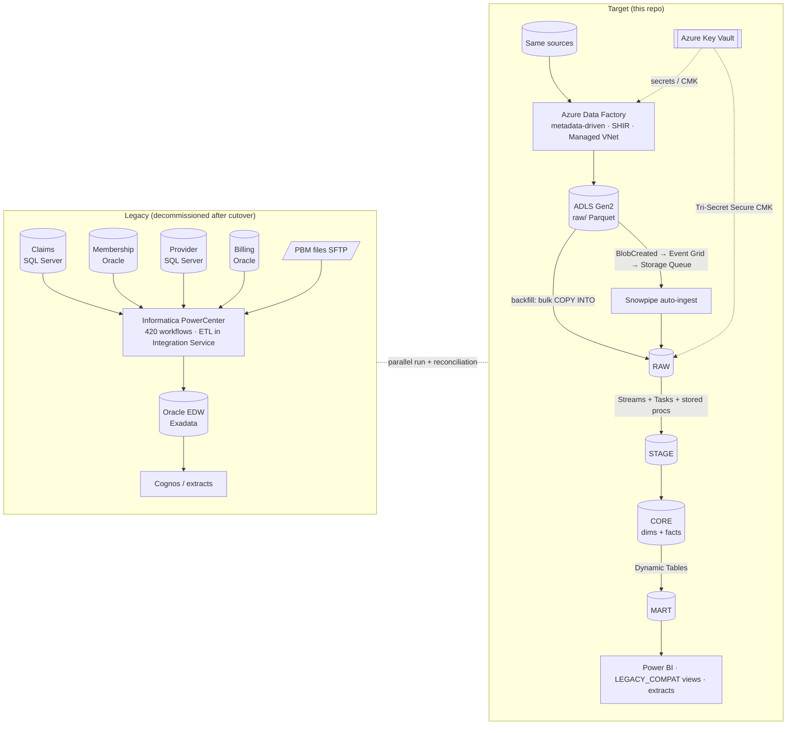

# High-Level Design

## 1. Context: legacy vs target



## 2. Architecture style: from ETL to ELT

| | Legacy (ETL) | Target (ELT) |
|---|---|---|
| Where transformation runs | PowerCenter Integration Service (row pipeline, fixed servers) | Snowflake virtual warehouses (set-based SQL, elastic) |
| Extract tool | PowerCenter source qualifier | ADF Copy Activity (no transformation, only column mapping + type-safe Parquet) |
| Load pattern | Truncate/insert or Update Strategy row-by-row | Land raw, then `MERGE` set-based |
| Re-processing | Re-extract from source | Re-run from immutable `raw/` Parquet or RAW tables (source untouched) |
| Business rules | Hidden in Expression/Router/Lookup transformations | SQL in Git, reviewed, tested, lineage-visible |

**Why ELT** (ADR-004): the data is already in Snowflake so compute is next to
storage; Snowflake scales per workload; raw data is kept so any rule can be
re-applied without re-extracting from source systems that allow a limited
extract window (02:00–04:30); and one engine means one lineage. We deliberately
did **not** use ADF Mapping Data Flows (Spark): they would split business logic
across two engines and add cluster cost and start-up latency.

**What stays "T" before the "L":** only non-business, technical conversions:
source query column projection, character-set normalisation, Parquet typing,
and the file trailer/row-count check for SFTP files. No business rule runs in ADF.

## 3. Layers

| Layer | Where | Purpose | Table type / retention |
|---|---|---|---|
| Landing | ADLS `raw/` | Immutable Parquet per run; replayable | Hot 30 d → Cool → Archive (lifecycle policy) |
| **RAW** | `CV_<ENV>_RAW` | As-landed + load metadata (`_file_name`, `_file_row`, `_load_ts`, `_batch_id`) | Permanent, 1-day Time Travel |
| **STAGE** | `CV_<ENV>_STAGE` | Typed, trimmed, deduped (latest per business key per batch), DQ-flagged | **Transient**, 1-day TT (no Fail-safe cost); purged after 3 days |
| **CORE** | `CV_<ENV>_CORE` | Conformed Kimball star: SCD2 dims, versioned facts, surrogate keys | Permanent, 30-day TT in PROD |
| **MART** | `CV_<ENV>_MART` | Subject-area aggregates as Dynamic Tables + secure views | DT lag 1 h / DOWNSTREAM |
| **LEGACY_COMPAT** | `CV_<ENV>_MART.LEGACY_COMPAT` | Views reproducing the old EDW table shapes and names | Views |
| **CONTROL / AUDIT / RECON** | `CV_<ENV>_CONTROL` | Batch runs, file log, feed status, DQ results, recon results, cutover checklist | Permanent |

See [DATA_MODEL.md](DATA_MODEL.md) for the full model.

## 4. Load paths

| Path | Trigger | Extract | Land | Load to Snowflake | Why |
|---|---|---|---|---|---|
| **Historical backfill** | Manual / tumbling window | ADF Copy with dynamic range partitions (by `claim_id` range or month) from `ctl.backfill_partition` | `raw/.../backfill/` | ADF Script activity → `COPY INTO` on `WH_BACKFILL` (XL, temporary) | Predictable throughput, one warehouse, no per-file Snowpipe overhead, 64-day load metadata |
| **Daily incremental** | Schedule 01:30 + tumbling window hourly for claims | Watermark query `updated_ts > old_wm AND <= new_wm` | `raw/.../load_date=/run_id=` | **Snowpipe auto-ingest** (serverless) | Event-driven, no warehouse to manage, loads as soon as the file lands |
| **PBM files** | Storage event on SFTP drop | Binary copy SFTP → ADLS, trailer validated | `raw/pbm/...` | Snowpipe | File-based partner feed |
| **Reference code sets** | Quarterly | Copy | `raw/reference/` | `COPY INTO` via task | Rare, full refresh |

## 5. Transformation engine inside Snowflake

```
RAW table ──(append-only STREAM)──▶ TASK t_stage_<entity> (WHEN SYSTEM$STREAM_HAS_DATA)
                                        CALL SP_STAGE_<entity>(batch)     -- type, dedupe, DQ, quarantine
                                     ─▶ TASK t_core_<entity>  (AFTER ...)
                                        CALL SP_MERGE_DIM_* / SP_MERGE_FACT_*   -- SCD2 / versioned facts
                                     ─▶ TASK t_publish        (AFTER all core tasks)
                                        CALL SP_PUBLISH_GATE(business_date)      -- feed status + recon
MART Dynamic Tables (TARGET_LAG = DOWNSTREAM / '1 hour') refresh from CORE
```

Why this split is covered in [STREAMS_TASKS_DYNAMIC_TABLES.md](STREAMS_TASKS_DYNAMIC_TABLES.md).

## 6. Orchestration boundaries

- **ADF owns** extraction, landing, watermarks, backfill partitions, SFTP, and
  kicks reconciliation + notifications. It is the "outside-in" scheduler.
- **Snowflake owns** everything after the file lands: Snowpipe, Streams,
  Tasks, Dynamic Tables. ADF does **not** call each transformation step (that
  would couple the two schedulers). ADF only (a) triggers `EXECUTE TASK` for
  the backfill DAG and (b) calls the recon procedure after the publish gate.
- **Logic Apps** send Teams/email alerts; **Azure Monitor / Log Analytics**
  collect ADF diagnostics; Snowflake **Alerts** watch pipe/task health.

## 7. Non-functional targets (illustrative)

| NFR | Target | How |
|---|---|---|
| Daily SLA | Claims + eligibility marts published by **05:30** (legacy 06:00, often missed) | Parallel extract (batchCount 8–16), Snowpipe, task DAG, DT lag |
| Backfill | 48 TB in < 3 weeks, restartable at partition granularity | Partitioned copies, SHIR scale-out, bulk COPY on XL |
| RPO / RTO | RPO 1 h, RTO 4 h for PROD | Time Travel, Fail-safe, account replication to paired region (ADR-015) |
| Security | HIPAA engineering controls | Business Critical, Private Link, masking, row access, Key Vault |
| Cost | ≤ 60 % of legacy run cost (illustrative) | Auto-suspend 60 s, resource monitors, transient STAGE, DT lags sized to need |

## 8. What we explicitly did not build

- No ADF Mapping Data Flows / Databricks — single engine (Snowflake) for business logic.
- No Snowpipe for the historical backfill (see §4).
- No materialized views for marts — Dynamic Tables support joins and multi-table aggregates; MVs don't.
- No Informatica-to-SQL auto-converter in production — we used the assessment
  tool for inventory and patterns, and engineers rewrote mappings set-based
  (auto-converted row-by-row logic performed badly and was unreadable).
