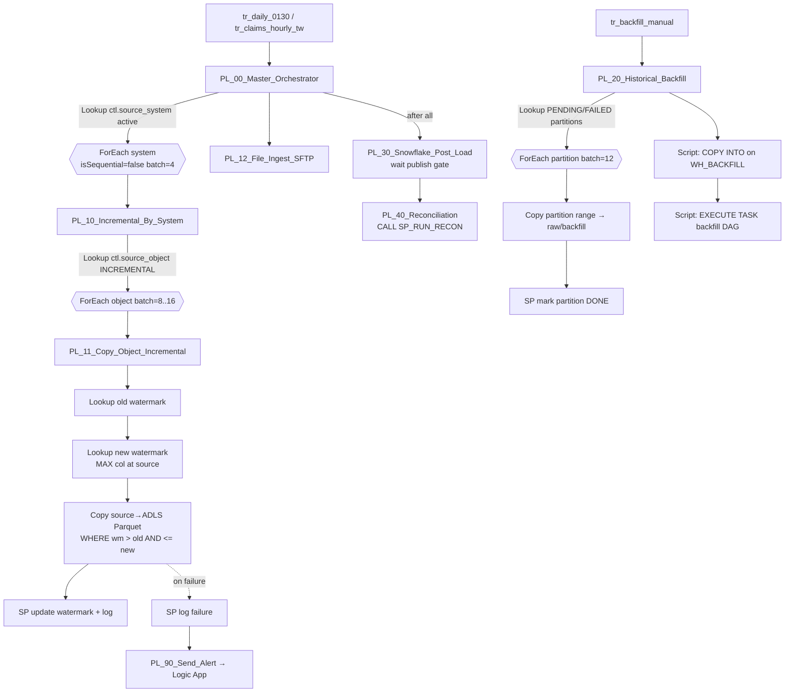

# Low-Level Design — Azure Data Factory (metadata-driven)

ADF JSON lives in [`/adf`](../../adf). Control-table seeds are in [`/metadata`](../../metadata).

## 1. Principle: one generic pipeline, many rows of metadata

Legacy had one PowerCenter workflow per table (420 of them). Target has **one
generic copy pipeline per load type**, driven by rows in the ADF control database
(Azure SQL DB, `ctl` schema). Onboarding a new table = insert one row + deploy
its Snowflake DDL. No new pipeline.

## 2. Control database (Azure SQL DB `sqldb-cv-adfctl`)

| Table | Grain | Key columns |
|---|---|---|
| `ctl.source_system` | system | `system_code`, `linked_service`, `extract_window_start/end`, `max_parallel_copies`, `is_active` |
| `ctl.source_object` | table/file | `object_id`, `system_code`, `schema_name`, `table_name`, `load_type` (`FULL`/`INCREMENTAL`/`FILE`), `watermark_column`, `watermark_type` (`DATETIME`/`ROWVERSION`/`SCN`), `primary_key`, `select_columns`, `partition_column`, `target_path`, `snowflake_table`, `criticality`, `priority`, `is_active` |
| `ctl.watermark` | object | `object_id`, `last_watermark`, `last_success_run_id`, `updated_at` |
| `ctl.backfill_partition` | object × range | `partition_id`, `object_id`, `range_start`, `range_end`, `status` (`PENDING`/`RUNNING`/`DONE`/`FAILED`), `rows_copied`, `attempts`, `last_error` |
| `ctl.pipeline_run` | run × object | `run_id`, `object_id`, `business_date`, `rows_read`, `rows_written`, `files_written`, `bytes_written`, `status`, `error`, `start_ts`, `end_ts` |

Stored procedures: `ctl.usp_get_objects`, `ctl.usp_get_backfill_partitions`,
`ctl.usp_update_watermark`, `ctl.usp_log_run_start/end`, `ctl.usp_mark_partition`.

Why Azure SQL DB and not Snowflake for ADF metadata: ADF `Lookup` + stored
procedure activities against Azure SQL are fast and free of warehouse resume
latency/credits for ~5 000 tiny lookups per night; Snowflake keeps the **data**
audit (`CONTROL` schema), and ADF pushes its run log there at the end of each run.

## 3. Pipelines

| Pipeline | Responsibility |
|---|---|
| `PL_00_Master_Orchestrator` | Business-date resolution, fan-out per system, SFTP, post-load, recon, alerts |
| `PL_10_Incremental_By_System` | Lookup active incremental objects for a system, ordered by priority; ForEach parallel |
| `PL_11_Copy_Object_Incremental` | Old/new watermark → bounded query → Parquet → watermark update (only on success) |
| `PL_12_File_Ingest_SFTP` | Get Metadata on SFTP → validate trailer count → binary copy to `raw/pbm/` → move to `processed/` |
| `PL_20_Historical_Backfill` | Restartable partitioned history load + bulk `COPY INTO` |
| `PL_30_Snowflake_Post_Load` | Polls `CONTROL.CTL_FEED_STATUS` until the publish gate passes (Until + Wait, timeout) |
| `PL_40_Reconciliation` | `CALL CONTROL.SP_RUN_RECON(:business_date)`; fails pipeline on critical breaks |
| `PL_90_Send_Alert` | Web activity to Logic App (Teams + email + ServiceNow incident) |

## 4. Watermark correctness (the most-asked question)

1. **New watermark is read *before* the copy**, from the source (`SELECT MAX(updated_ts)`),
   and the copy is bounded `> old AND <= new`. Rows committed during the copy are
   picked up next run — never lost, never double-read.
2. **Watermark is updated only after** the copy succeeds *and* row counts are logged.
   A failed run leaves the old watermark → the next run re-reads the same window.
   Duplicates from partial writes are harmless because the RAW → STAGE step
   deduplicates on business key + `updated_ts`, and the run folder `run_id=` is new.
3. **Clock skew / late commits**: SQL Server claims uses a **`rowversion`** column
   (monotonic, commit-ordered) instead of a timestamp; Oracle uses `ORA_ROWSCN`
   / `last_update_ts` with a **15-minute look-back overlap**, deduped downstream.
4. **Deletes**: sources soft-delete (`status='VOID'`) for claims; for membership
   hard deletes, a weekly **key-only full extract** feeds an anti-join to mark
   `is_deleted` in CORE.

## 5. Historical backfill design

- `ctl.backfill_partition` pre-splits every large table by **month of service
  date** (claims: 144 months × ~17 M lines) and further by `claim_id` range when a
  month exceeds 50 M rows. ~3 100 partitions total.
- ADF Copy uses **source partition option** (`DynamicRange` for SQL Server,
  `PhysicalPartitionsOfTable` for Oracle partitioned tables) → parallel reads.
- `parallelCopies` 16–32, SHIR on **4 nodes** (scaled out only for the backfill
  weeks), `dataIntegrationUnits` n/a for SHIR (auto for Azure IR).
- Output: Snappy Parquet, `maxRowsPerFile` tuned so files are **128–256 MB** —
  the sweet spot for Snowflake `COPY` parallelism.
- **Restartable**: ForEach picks only `PENDING`/`FAILED` partitions; each
  partition writes to its own folder, so re-running overwrites only itself.
- Throttling: backfill runs outside the 02:00–04:30 extract window, during
  source-DBA-agreed hours, with `max_parallel_copies` per system to protect OLTP.
- Load to Snowflake: after a wave of partitions lands, a Script activity runs
  `COPY INTO … FROM @stage/claims/backfill/ PATTERN='…' ` on `WH_BACKFILL` (XL).

## 6. Security in ADF

- ADF **system-assigned managed identity** → ADLS (`Storage Blob Data Contributor`),
  Key Vault (`Key Vault Secrets User`), Azure SQL control DB (AAD user).
- Source DB passwords and the **Snowflake key-pair private key** are
  `AzureKeyVaultSecret` references — never inline. `src/tools/adf_validate.py`
  fails CI if any linked service contains a literal password/connection string.
- **Self-hosted IR** (2 nodes HA, 4 during backfill) inside the on-prem network
  reaches SQL Server/Oracle; **Azure IR with Managed VNet** + managed private
  endpoints reaches ADLS, Key Vault and Snowflake (Private Link).
- Git integration (Azure Repos/GitHub) with `adf_publish` → ARM templates → CI/CD
  with environment parameter files; triggers stopped/started around deployment.

## 7. Error handling & retries

| Level | Mechanism |
|---|---|
| Activity | `retry: 3`, `retryIntervalInSeconds: 120` on Copy/Lookup (transient network/SHIR) |
| Object | Failure path → `usp_log_run_end(status='FAILED')` → alert; other objects continue (ForEach is not fail-fast) |
| Pipeline | Master checks `ctl.pipeline_run` for failed *critical* objects → sets feed status `FAILED` so the Snowflake publish gate blocks |
| Data | Row-count check source vs written (`rowsRead == rowsCopied`), else fail the object |
