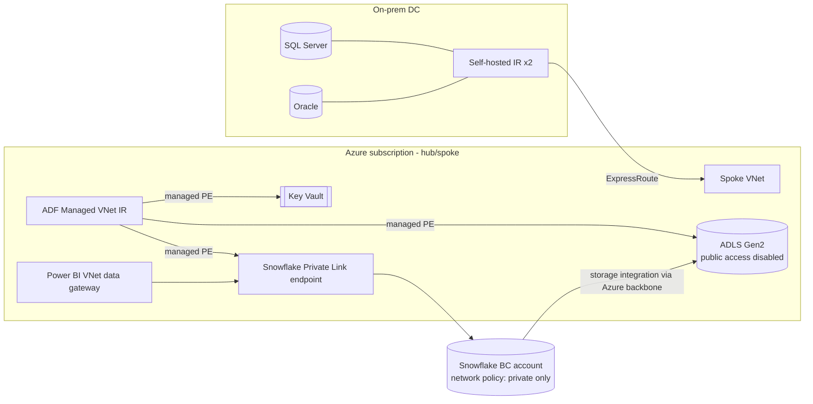

# Security & HIPAA engineering controls

> Engineering controls only. HIPAA compliance is an organisational programme
> (policies, BAAs, risk assessments); this document shows how the platform
> supports it.

## 1. Network



- ADLS: public network access **disabled**; private endpoints for `dfs`/`blob`/`queue`;
  Snowflake's service subnets allowed via storage **resource instance rules**
  (or Snowflake private connectivity for internal stages/external stages on Azure).
- Snowflake: **network policy** allows only Private Link and the corporate egress
  range; `SR_*` service users additionally restricted to ADF/CI egress.
- SHIR sits in on-prem DMZ; outbound 443 only.

## 2. Identity & secrets — Azure Key Vault

| Secret / key | Stored in | Used by | Rotation |
|---|---|---|---|
| SQL Server / Oracle service account passwords | Key Vault `kv-cv-data-prod` | ADF linked services (`AzureKeyVaultSecret`) | 90 days, dual-secret swap |
| **Snowflake private key (RSA 2048, key-pair auth)** for `SVC_ADF_LOADER` | Key Vault secret | ADF Snowflake V2 linked service | 180 days via `RSA_PUBLIC_KEY_2` then unset old |
| SFTP key for PBM | Key Vault | ADF SFTP linked service | Partner-driven |
| **Tri-Secret Secure CMK** | Key Vault **Managed HSM / Premium** key | Snowflake (composite master key) | Annual; revoking it makes the account data unreadable (kill switch) |
| Logic App / Teams webhooks | Key Vault | ADF Web activity (via KV reference) | As needed |

- ADF authenticates to Key Vault, ADLS and the control DB with its **system-assigned
  managed identity** — no credentials anywhere in ADF JSON.
- Snowflake → ADLS: **storage integration** (Entra ID multi-tenant app +
  RBAC `Storage Blob Data Reader` on the `raw` container only). No SAS tokens.
- Snowflake → Event Grid queue: **notification integration** (`Storage Queue Data Contributor`).
- Humans: **SSO with Entra ID (SAML2/SCIM)**; roles provisioned from AD groups by
  SCIM; MFA enforced at IdP; no local passwords.

## 3. Snowflake access model

```
ACCOUNTADMIN (break-glass only, 2 named people, MFA)
 └─ SYSADMIN ── owns databases via
      ├─ <ENV>_SR_INGEST      (service: ADF/Snowpipe)       → RAW write
      ├─ <ENV>_SR_TRANSFORM   (service: tasks/procs)        → RAW read, STAGE/CORE/MART write
      ├─ <ENV>_SR_RECON       (service: recon)              → CORE read, CONTROL.RECON write, legacy stage read
      ├─ <ENV>_FR_DATA_ENGINEER  → all read (PHI masked), DEV write
      ├─ <ENV>_FR_ACTUARY        → CORE + MART read, PHI masked except DOB→year
      ├─ <ENV>_FR_CLAIMS_OPS     → MART.CLAIMS, row access Commercial+MA
      ├─ <ENV>_FR_MEDICAID_ANALYST → row access: Medicaid only
      ├─ <ENV>_FR_PHI_STEWARD    → unmasked PHI (audited)
      └─ <ENV>_FR_BI_SERVICE     → MART + LEGACY_COMPAT read
 SECURITYADMIN/USERADMIN → roles, grants, SCIM
```

Access roles (`_AR_<DB>_R/RW`) hold object privileges; functional roles (`_FR_`)
are granted access roles. **Future grants** on schemas so new tables are covered.

## 4. PHI protection

| Control | Implementation |
|---|---|
| Classification | Tag `GOVERNANCE.TAGS.PHI_CLASS` ∈ {`DIRECT_ID`,`QUASI_ID`,`CLINICAL`,`NONE`}; initial tagging assisted by `SYSTEM$CLASSIFY` / auto-classification, then reviewed |
| **Tag-based masking** | Masking policies attached **to the tag**, so any new column tagged `DIRECT_ID` is masked automatically: names → `***`, SSN → last 4, DOB → year only for actuaries, member_id → SHA2 token for non-PHI roles (joinable) |
| **Row access policy** | `RAP_LOB` on facts/dims via mapping table `GOVERNANCE.LOB_ROLE_MAP` (role → allowed LOBs) |
| Minimum necessary | Facts carry surrogate keys only; PHI lives only in member/subscriber dims |
| Non-prod | QA/DEV built by **zero-copy clone** of PROD *with masking policies intact* (policies travel with the clone); engineers have no unmask role in NONPROD |
| Audit | `ACCESS_HISTORY` (column-level reads), `LOGIN_HISTORY`, `QUERY_HISTORY` exported daily to Log Analytics / SIEM (Sentinel) |
| Encryption | At rest AES-256 (Snowflake) + **Tri-Secret Secure CMK**; ADLS SSE with CMK; TLS 1.2 in transit |
| Data retention | Time Travel 30 d on CORE; Fail-safe 7 d; ADLS raw retention per records policy (10 years claims) |
| Export control | Stage creation restricted (`PREVENT_UNLOAD_TO_INLINE_URL`, `REQUIRE_STORAGE_INTEGRATION_FOR_STAGE_CREATION/OPERATION = TRUE`) → no data exfiltration to arbitrary URLs |

## 5. Informatica-era problems this fixed

- Plain-text passwords in PowerCenter parameter files → Key Vault references.
- Full PHI copies in 6 dev/test Oracle schemas → masked zero-copy clones.
- Shared `INFA_USER` DB account → per-service Snowflake users, key-pair auth.
