# Migration Strategy — PowerCenter + Oracle EDW → ADF + ADLS + Snowflake

## 1. Phases

```mermaid
gantt
  title CareVista migration (illustrative, 14 months)
  dateFormat  YYYY-MM-DD
  section Assess
  Inventory & complexity scoring (XML export) :a1, 2025-07-01, 30d
  Target architecture & PoC (claims 1 month)   :a2, after a1, 30d
  section Foundation (Wave 0)
  Azure landing zone, SHIR, Key Vault, ADLS     :f1, 2025-09-01, 30d
  Snowflake accounts, RBAC, integrations, CI/CD :f2, 2025-09-01, 40d
  ADF metadata framework + control DB           :f3, 2025-09-15, 35d
  section Build & backfill
  Wave 1 reference + provider                   :w1, 2025-10-20, 35d
  Wave 2 membership / eligibility               :w2, after w1, 45d
  Wave 3 claims (+ 48 TB backfill)              :w3, after w2, 75d
  Wave 4 premium billing + MLR                  :w4, after w3, 40d
  Wave 5 pharmacy + regulatory + compat views   :w5, after w4, 35d
  section Prove
  Parallel run + daily reconciliation           :p1, 2026-03-01, 100d
  3 clean month-ends (Mar, Apr, May)            :milestone, p2, 2026-06-05, 0d
  section Cutover
  Cutover weekend                               :c1, 2026-06-13, 2d
  Hypercare                                     :c2, after c1, 30d
  Decommission PowerCenter + EDW read-only      :c3, after c2, 60d
```

## 2. Assessment (what we inventoried)

The PowerCenter repository was exported (`pmrep objectexport`) to XML per
folder. [`src/tools/informatica_inventory.py`](../../src/tools/informatica_inventory.py)
parses exports into [`informatica_legacy/inventory/assessment.csv`](../../informatica_legacy/inventory/)
with, per mapping: sources, targets, transformation counts by type, lookups,
SQL overrides, stored procedure calls, parameters, and a **complexity score**
that drives effort and wave assignment.

| Complexity | Rule (simplified) | Count | Target pattern |
|---|---|---|---|
| **Simple** (score ≤ 5) | SQ → (Expression/Filter) → target, no lookups | 238 | Metadata row in ADF + RAW only; logic in a generic STAGE view |
| **Medium** (6–15) | Lookups, routers, aggregators, update strategy | 131 | Stored procedure / Dynamic Table per mapping |
| **Complex** (> 15) | SCD2, normalizers, java/stored-proc transformations, mapplets, SQL overrides | 51 | Hand-redesigned set-based SQL, pair-reviewed, extra recon rules |
| Retired | Unused targets (no reads in 12 months from Oracle audit) | ~70 of the 490 found | Not migrated |

The retire list mattered: **~14 % of workflows fed tables nobody read**.

## 3. Principles

1. **Re-engineer, don't transliterate.** Row-by-row mapping logic becomes set-based SQL.
2. **Preserve business rules, not implementation.** Every Expression/Router rule
   is captured as a documented rule ID (e.g. `CLM-R-017: reversal lines carry
   negative paid_amt`) and becomes a reconciliation rule.
3. **Raw first.** Land everything unchanged; re-run transformations freely.
4. **Same numbers before better numbers.** Known legacy defects are reproduced
   during parallel run (flagged `LEGACY_PARITY`), fixed **after** cutover with
   business sign-off — otherwise recon can't distinguish bugs from fixes.
5. **Consumers switch by connection, not rewrite** (LEGACY_COMPAT views).

## 4. Per-wave definition of done

- ADF metadata rows + Snowflake DDL/procs deployed via CI to QA.
- Backfill complete for the wave's tables; row counts match source by partition.
- Recon levels 1–5 green for 10 consecutive business days in QA-on-PROD-data.
- Downstream compat views validated by report owners.
- Runbooks + alerts in place; support team walkthrough done.

## 5. Risks & mitigations

| Risk | Mitigation |
|---|---|
| Source extract window (02:00–04:30) too short for parallel legacy + ADF extracts | Read from AG secondary / read replica for ADF; legacy kept on primary |
| Hidden logic in SQL overrides and stored procedures called from mappings | Parser flags `Sql Query` overrides and `Stored Procedure` transformations; each reviewed |
| Decimal/rounding differences (Informatica `decimal` high precision vs default double) | Recon type-level checks; explicit `ROUND(x,2)` at the same step as legacy |
| Null vs empty string (Oracle treats `''` as NULL) | `NULLIF(TRIM(x),'')` in STAGE to mimic Oracle semantics; documented |
| Date/timezone (Oracle DATE local time vs UTC) | Business dates kept as `DATE`; technical timestamps UTC; conversion rule per source |
| Case sensitivity (Oracle uppercase identifiers) | All Snowflake identifiers unquoted uppercase |
| Sort-order dependent logic (Informatica "first/last" in aggregator) | Explicit `QUALIFY ROW_NUMBER() OVER (… ORDER BY …)` with deterministic tie-breaker |
| Downstream consumers unknown | Oracle `DBA_AUDIT_TRAIL` + network logs → consumer list; each compat view has an owner |
