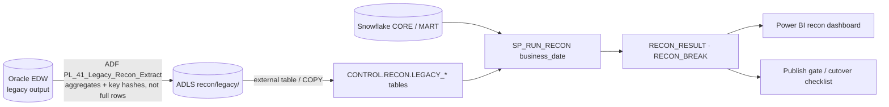

# Reconciliation framework — legacy (Oracle EDW) vs new (Snowflake)

Cutover was gated on reconciliation (ADR-016). It ran **daily** during the
3-month parallel run and at every month-end close.

## 1. How legacy data gets to the comparison

We **don't** copy full legacy tables for every check. Legacy side computes
aggregates and per-key hashes in Oracle (cheap, pushed down), and ships those.
Full-row diffs are pulled only for keys that break (drill-down).

## 2. Six levels

| Level | Check | Example rule | Tolerance |
|---|---|---|---|
| **L1 Row counts** | Count per table × business date × LOB | `FACT_CLAIM_LINE` rows for 2026-05-31 | exact (0) |
| **L2 Amount / measure totals** | Σ of every money column per date × LOB × claim type | Σ `paid_amt`, `allowed_amt`, `billed_amt` | 0.00 |
| **L3 Key-level hash diff** | `SHA2` of business key + tracked columns, compared per key | Missing in new / missing in legacy / hash mismatch | 0 breaks for critical tables |
| **L4 Schema & data type parity** | Column list, type, precision/scale, nullability vs legacy mapping spec | `paid_amt NUMBER(18,2)` vs Oracle `NUMBER(15,2)` (widening allowed, narrowing not) | rule-based |
| **L5 Business rule parity** | Each documented rule ID re-checked on both sides | `CLM-R-017` reversals negative; `ELG-R-004` one active span per member/day; `MBR-R-009` SCD2 no overlaps | 0 violations new where legacy has 0 |
| **L6 Report / KPI parity** | Final KPIs as consumers see them | PMPM, MLR, member months, denial rate, IBNR triangle cells | exact for money; 0.01 pp for rates |

Plus **distribution checks** (min/max/null %/distinct count per column) to catch
silent defaulting — e.g. everything mapped to `member_sk = -1`.

## 3. Engine

- **SQL (`SP_RUN_RECON`)** in [`snowflake/10_reconciliation/`](../../snowflake/10_reconciliation):
  rules are rows in `CONTROL.RECON.RECON_RULE` (level, table, grain columns,
  measure expression, tolerance, criticality). The proc builds and runs one
  comparison query per rule, writes `RECON_RESULT` (one row per rule × grain
  value) and `RECON_BREAK` (key-level for L3).
- **Python (`src/recon/`)** does the same comparison offline on extracts —
  used in CI with synthetic data and for ad-hoc investigations
  (`make recon`). Its break categories match the SQL engine's.

## 4. Break triage workflow

| Break category | Typical root cause | Owner |
|---|---|---|
| `MISSING_IN_NEW` | Watermark gap, late file, quarantine, filter rule missing | Data engineering |
| `MISSING_IN_LEGACY` | Legacy router dropped row, legacy late run | Analyst + legacy team |
| `VALUE_MISMATCH` | Rounding step, null vs empty, lookup tie-break, timezone | Data engineering |
| `TYPE_MISMATCH` | DDL narrowing, Parquet decimal → float in a source query | Data engineering |
| `RULE_VIOLATION` | Logic gap in SP | Data engineering + BA |
| `KPI_VARIANCE` | Aggregation/filter definition difference | BA + finance |

Every break gets a disposition: `FIXED`, `LEGACY_DEFECT` (accepted, documented,
signed off by business owner), `TIMING` (auto-clears next day), or `OPEN`.

## 5. Cutover exit criteria

1. L1–L3 zero open breaks on critical tables (claims, eligibility, member, premium) for **10 consecutive business days**.
2. L6 KPIs match for **3 consecutive month-end closes** (finance sign-off).
3. All `LEGACY_DEFECT` dispositions signed by the data owner.
4. Performance: daily SLA met on 95 % of parallel-run days.
5. Runbooks rehearsed (restore, replay, rollback).

## 6. Numbers from the parallel run (illustrative)

| Week | Open breaks (critical) | Top cause |
|---|---|---|
| 1 | 41 | Null vs empty string (Oracle) |
| 3 | 17 | Aggregator last-row semantics |
| 6 | 5 | Late adjustments crossing midnight UTC |
| 9–13 | 0 | — (cutover approved) |
